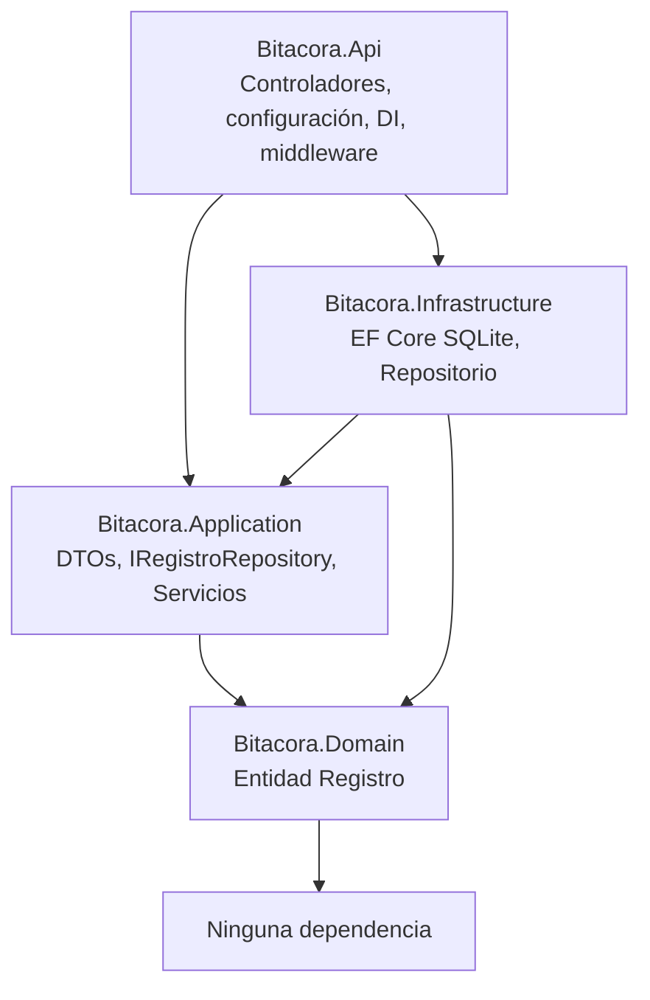
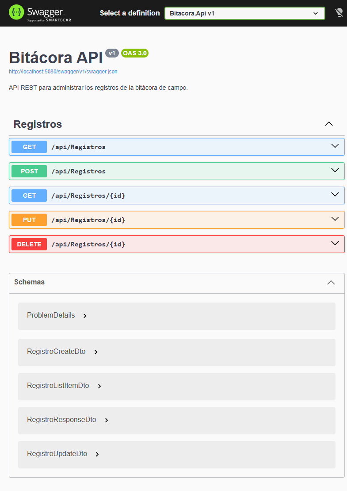

# Informe - Tarea 2.2 API REST Bitácora

## Diagrama de capas y dependencias

Regla de dependencias: todas las capas dependen hacia el dominio. El dominio no conoce a ningún otro proyecto.

## Captura de Swagger

## Pruebas en Postman

Colección: `docs/Bitacora.postman_collection.json`
Entorno: `docs/Bitacora.postman_environment.json` (variable `baseUrl`).

Casos incluidos:
- GET `/api/registros` exitoso (200) y verificación de que no incluye la foto.
- GET `/api/registros/{id}` exitoso (200) y fallido (404).
- POST `/api/registros` exitoso (201 con Location) y fallido (400 por validación).
- PUT `/api/registros/{id}` exitoso (200), fallido por validación (400) y fallido por no existir (404).
- DELETE `/api/registros/{id}` exitoso (204) y fallido (404).

## Distribución del trabajo

| Integrante | Número de cuenta | Responsabilidad |
|------------|------------------|-----------------|
| Angel Manuel Rivera | 202330010471 | Estructura de la solución, proyectos y referencias. |
| Anthony Joel Gonzales Juárez | 202310010114 | Entidad de dominio y DTOs con validaciones. |
| Brayan wilfredo Torres aguilar | 201820030041 | Repositorio EF Core, DbContext y migraciones. |
| Johan Moises Lopez Moran | 202220010502 | Controladores, middleware de errores y configuración Swagger. |
| Luis David Diaz Medina | 202210010189 | Colección de Postman, README y documentación. |
