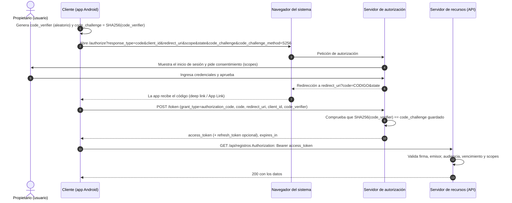

# Investigación: OAuth 2.0

## 1. ¿Qué es?

OAuth 2.0 es un protocolo de **autorización delegada**: permite que una aplicación obtenga acceso limitado a los datos
de un usuario en otro servicio **sin conocer su contraseña**. Por ejemplo, una app de fotos que lee tus archivos de
Google Drive: el usuario inicia sesión en Google, no en la app, y Google le entrega a la app un token con permisos acotados.

## 2. Participantes

| Participante | Qué es | Ejemplo en la Bitácora (si se usara OAuth) |
|---|---|---|
| **Propietario del recurso** (resource owner) | La persona dueña de los datos que autoriza el acceso. | El técnico de campo dueño de sus registros. |
| **Cliente** (client) | La aplicación que quiere acceder a los datos en nombre del propietario. | La app Android de la Bitácora. |
| **Servidor de autorización** (authorization server) | Autentica al propietario, pide su consentimiento y emite los tokens. | Un proveedor de identidad (Keycloak, Microsoft Entra ID, Google, Auth0…). |
| **Servidor de recursos** (resource server) | Aloja los datos protegidos y acepta solo peticiones con un token de acceso válido y con los permisos necesarios. | La API REST de la Bitácora (ASP.NET Core). |

## 3. Permisos (scopes)

Un *scope* es un permiso concreto y limitado que el cliente pide y el propietario aprueba. El token de acceso solo vale
para esos scopes. En la Bitácora podrían ser:

- `bitacora.read`: leer registros.
- `bitacora.write`: crear y modificar registros propios.
- `bitacora.delete`: eliminar registros.

La app pide solo los que necesita (principio de mínimo privilegio) y la API comprueba que el token incluya el scope
adecuado en cada endpoint. Es distinto de un **rol** (Admin/Usuario): el rol describe *quién es* el usuario dentro del
sistema; el scope describe *qué le permitió el usuario a esa aplicación concreta*.

## 4. Flujo de código de autorización con PKCE (aplicaciones móviles)

Las apps móviles son **clientes públicos**: no pueden guardar un secreto de cliente, porque cualquiera podría extraerlo
del APK. Por eso se usa el flujo de **código de autorización** con **PKCE** (*Proof Key for Code Exchange*, RFC 7636),
que reemplaza al secreto con una prueba que se genera en cada inicio de sesión:

- `code_verifier`: cadena aleatoria secreta que genera la app.
- `code_challenge`: hash SHA-256 del verifier (en Base64URL), que sí viaja en la primera petición.



Si el diagrama no se ve en su editor, esta es la versión en texto:

```
App Android          Navegador            Servidor de autorización        API (recursos)
    |  1. genera verifier y challenge           |                              |
    |-- 2. abre /authorize + challenge -------->|                              |
    |                       |  3. login + consentimiento del usuario           |
    |<-- 4. redirect con ?code=... -------------|                              |
    |-- 5. POST /token (code + verifier) ------>|                              |
    |        6. verifica SHA256(verifier) == challenge                         |
    |<-- 7. access_token (y refresh_token) -----|                              |
    |-- 8. GET /api/registros  Bearer access_token ------------------------->  |
    |<-- 9. 200 (la API valida firma, vencimiento, audiencia y scopes) ------  |
```

**¿Por qué PKCE?** Si una app maliciosa interceptara el `code` de la redirección (paso 4), no podría canjearlo por un
token porque no conoce el `code_verifier`, que nunca salió de la app legítima. Además la app usa el **navegador del
sistema** (no un WebView) para que sus credenciales las vea solo el servidor de autorización, nunca la app.

## 5. Diferencia con el login con JWT que implementamos

| | Login con JWT (nuestra API) | OAuth 2.0 con código + PKCE |
|---|---|---|
| **Quién autentica al usuario** | Nuestra propia API (`POST /api/auth/login`). | Un servidor de autorización independiente. |
| **Dónde se escribe la contraseña** | **Dentro de la app**, que la envía a nuestra API. La app la conoce. | En la página del servidor de autorización; **la app nunca ve la contraseña**. |
| **Propósito** | Autenticación propia y simple: “quién eres”. | **Autorización delegada**: “qué permite el usuario que haga esta aplicación”. |
| **Permisos** | Rol fijo dentro del token (`Admin` / `Usuario`). | Scopes aprobados por el usuario, por aplicación. |
| **Roles de sistema** | API = servidor de autorización **y** de recursos a la vez. | Servidores separados. La API solo valida tokens. |
| **Tokens** | Un solo token de acceso (10 min); al vencer, se vuelve a iniciar sesión. | Token de acceso corto + refresh token para renovarlo sin pedir la contraseña. |
| **Inicio de sesión único / terceros** | No: cada app tendría que implementar su propio login. | Sí: varias apps y proveedores (Google, Microsoft) comparten la identidad. |
| **Complejidad** | Baja: ideal para un sistema pequeño con una sola app. | Mayor: requiere un servidor de autorización, redirecciones y manejo de PKCE. |

**Relación entre ambos:** no son excluyentes. El `access_token` que emite un servidor OAuth 2.0 muchas veces *es* un JWT,
y la API lo valida igual que validamos el nuestro (firma, emisor, audiencia, vencimiento). Lo que cambia es **quién lo emite
y cómo se obtiene**. Para escalar la Bitácora (varias aplicaciones, inicio de sesión corporativo, no manejar contraseñas)
convendría delegar la autenticación a un proveedor de identidad con OAuth 2.0 / OpenID Connect y dejar que la API solo
valide los tokens.

## Referencias

- RFC 6749: *The OAuth 2.0 Authorization Framework*.
- RFC 7636: *Proof Key for Code Exchange (PKCE)*.
- RFC 8252: *OAuth 2.0 for Native Apps* (buenas prácticas para apps móviles).
- RFC 7519: *JSON Web Token (JWT)*.
